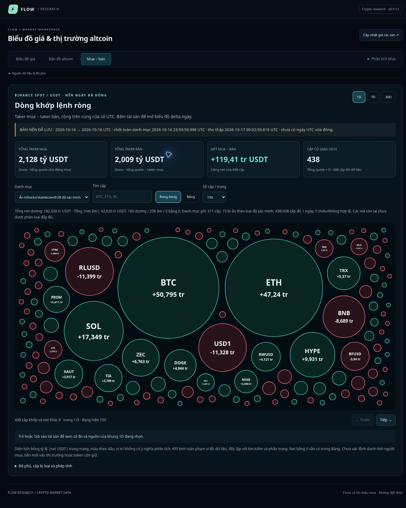

# Flow Research v0.9.12 verification — 2026-10-18

Public build checked in the authenticated user's browser environment: `https://phuongdinh92.github.io/flow-research/?v=9912c#netflow`. The Flow page itself is public and does not use the A1 login. Implementation commit: `6df5d4d42cd30f4020bbe2bae5a00292496b42e5`.

## Verification completed

- Required local Node gate: **464 passed, 0 failed**, including retained-source arithmetic and archive-cutoff regressions. Independent code review found no remaining blocker in the arithmetic, missing/zero handling, preview guard, preserved generation on failure or exact-token chart navigation.
- Actual browser controls: 1D, 7D, 30D, search, table/bubbles and asset drilldown. Coverage matches the source replay: 438/438, 433/438 and 418/438 after the current verified class exclusions; missing histories are reported separately.
- Actual browser BTC 30D table: taker buy 19,578,260,788.694065; sell 20,422,822,654.551353; net −844,561,865.857288 USDT. The chart exposes exactly 30 daily points from 2026-09-17 through 2026-10-16. Summing their rendered delta labels gives −844,561,865.8572878 USDT, differing by approximately 0.00000024 due to binary floating-point arithmetic and displayed rounding.
- Short-history check: BBBUSDT is available in the 1D view, excluded from the 7D view, and opens its actual three daily bars (October 14–16) rather than another asset or a fabricated complete history.
- A real browser check discovered the previous terminal cropping its saved history relative to today's date. The fix now anchors terminal and both legacy modal windows to the last actual closed candle while retaining the real clock for stale/future checks.
- Visual check found global SVG font rules overriding proportional text sizes. Dedicated inherited text sizing now keeps large labels readable and hides labels in the smallest circles; exact values remain available through inspection and the table. The final screenshot below was inspected after deployment.

## Operational limits

The archive still ends **2026-10-16 23:59:59.999 UTC**. This release did not refresh the entire archive or restore scheduled collection. GitHub Pages deployment succeeded. The custom GitHub Verify workflow still failed before any job steps ran; that is not reported as a passing hosted test. Local verification and publication are separate outcomes.

These measurements cover Binance executed aggressor flow in USDT. They do not establish wallet identities, new capital entering crypto, token retention, A1 model equivalence or profitable early-accumulation signals. Instrument-class exclusions are explicitly incomplete.

